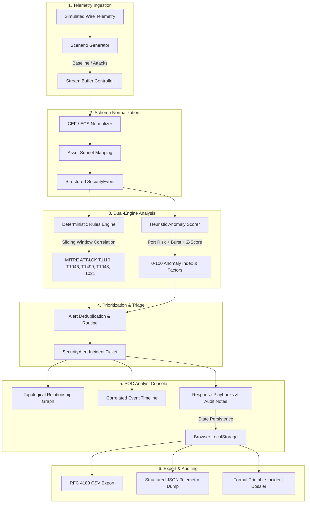

# SentinelAI — Intelligent Threat Detection & Security Operations Platform

[](https://opensource.org/licenses/Apache-2.0)
[](https://www.typescriptlang.org/)
[](https://react.dev/)
[](https://tailwindcss.com/)
[](https://recharts.org/)

**SentinelAI** is an industry-grade Security Operations Center (SOC) and autonomous threat detection platform built with React, TypeScript, and Tailwind CSS. Designed as an engineering portfolio demonstration for AI, software engineering, and cybersecurity internships, it models production SIEM pipelines—from wire telemetry ingestion and schema normalization to deterministic MITRE ATT&CK correlation, statistical anomaly scoring, topological relationship graphing, and compliance reporting.

---

## 📌 Problem Statement

Traditional introductory cybersecurity projects often suffer from two extremes:
1. **Static, non-functional UI mockups** with placeholder buttons and fabricated claims of AI capabilities.
2. **Opaque CLI scripts** that lack visual observability and cannot demonstrate real-time SecOps triage, incident lifecycle workflows, or forensic graph relationships.

Enterprise Security Operations Centers face genuine challenges: **alert fatigue**, **high Mean Time to Detect (MTTD)**, and the friction of correlating disparate logs. **SentinelAI** demonstrates how modern frontend architectures can combine **deterministic signature rules** (for precise compliance) with an **explainable multi-factor anomaly scoring engine** to provide actionable triage workflows without proprietary dependencies or paid API keys.

---

## 🏗️ System Architecture & Data Flow



---

## 🚀 Key Features

### 1. Security Overview Dashboard
- High-level SOC KPIs: Total Analyzed Events, Suspicious Outliers, Critical Alerts, and Resolved Incidents.
- Real-time **Recharts** visualizations: Ingestion velocity vs. Anomaly trends (`AreaChart`), Severity breakdown donut (`PieChart`), and Protocol distribution (`BarChart`).
- Quick incident launchpad with direct drill-down links.

### 2. Live Threat Monitor
- Real-time packet telemetry stream with Play / Pause / Single-Step and variable speed controls (1x, 2x, 5x, 10x).
- Multi-dimensional filtering by Protocol (HTTPS, HTTP, SSH, SMB, DNS, TCP, UDP), Event Status (ALLOW, DENY, FAILED_AUTH, SUSPICIOUS), and Anomaly Score slider threshold.
- Full-text search across Source/Destination IPs, Event Types, and Origin Countries.
- Raw packet payload & TCP header modal with hexadecimal and ASCII inspection.

### 3. Threat Detection Engine
- Transparent, deterministic client-side detection rules mapped directly to MITRE ATT&CK techniques:
  - **RULE-AUTH-001 (T1110 Credential Access)**: Detects $\ge 4$ failed logins in 60s sliding window.
  - **RULE-NET-002 (T1046 Discovery)**: Detects multi-port service probes across $\ge 4$ distinct ports in 45s.
  - **RULE-DOS-003 (T1499 Impact)**: Detects request flooding ($>12$ req/15s).
  - **RULE-EXFIL-004 (T1048 Exfiltration)**: Detects abnormal outbound transfers $>2.5$ MB.
  - **RULE-PORT-005 (T1021 Lateral Movement)**: Flags unauthorized traffic to sensitive admin ports (23, 445, 3389, 4444).
- **Interactive Anomaly Scoring Sandbox**: Sliders to test how port vulnerability, burst frequency, and payload volume combine into a bounded $0 - 100$ risk score.

### 4. Forensic Incident Investigation & Graph
- Complete incident dossier: Root-cause explanation, quantitative evidence metrics table, and recommended containment playbooks.
- **Topological Relationship Graph**: Interactive SVG network topology linking the Attacker Host, Target Server, Target Ports, and Alert nodes with clickable entity inspection.
- Lifecycle state transitions (`OPEN` $\rightarrow$ `INVESTIGATING` $\rightarrow$ `RESOLVED`) with analyst audit notes stored persistently in browser `localStorage`.

### 5. Interactive Cybersecurity Glossary
- Plain-English explanations, real-world examples, and technical deep-dives for fundamental concepts:
  - *SIEM, Anomaly Detection, False Positive, Port Scanning, Source IP, Severity, MITRE ATT&CK, Zero Trust, C2 Beaconing, MTTD/MTTR.*
- Direct mapping explaining how each term functions inside SentinelAI.

### 6. Interactive 7-Stage Workflow Pipeline
- Animated step-by-step pipeline view:
  1. Event Generation $\rightarrow$ 2. Event Normalisation $\rightarrow$ 3. Detection Rules $\rightarrow$ 4. Anomaly Scoring $\rightarrow$ 5. Alert Prioritisation $\rightarrow$ 6. Investigation $\rightarrow$ 7. Incident Resolution.
- Interactive side-by-side JSON comparison showing raw inputs versus enriched output payloads at each stage.

### 7. Reports & Compliance Export
- **RFC 4180 compliant CSV Export**: Downloads a sanitized `.csv` spreadsheet file generated entirely client-side.
- **Full JSON Dump**: Downloads telemetry and incident dossiers for external ingestion.
- **Printable Executive Incident Dossier**: Clean, print-friendly layout triggered via `window.print()` with `@media print` styles and executive sign-off blocks.

### 8. System Tests & Automated Diagnostics
- In-browser unit test runner executing 6 automated assertions covering:
  - Rule triggers on malicious traffic (True Positives).
  - Negative control test (Verifies normal baseline HTTPS traffic never triggers false alarms).
  - Anomaly scoring mathematical boundaries $[0, 100]$.
  - RFC 4180 CSV character escaping.

---

## 🔍 Implemented vs. Simulated Features

To maintain scientific integrity and transparent engineering communication during technical interviews:

| Feature Dimension | What is Implemented in Code | What is Simulated |
| :--- | :--- | :--- |
| **Detection Engine** | **100% Real Logic**: Deterministic rules evaluate temporal windows, count failed credentials, analyze port diversity, and flag alerts. | N/A |
| **Anomaly Scoring** | **100% Real Logic**: Mathematical multi-factor weighted sum algorithm computing bounded $0-100$ scores with factor attribution. | N/A |
| **Network Traffic** | Event data structures and parsing are 100% functional. | Packet telemetry is **synthetically generated** in browser memory; no real user packets are captured from the physical NIC. |
| **Alerts & Notes** | Real state machine with persistent browser `localStorage` storage and triage transitions. | Alerts model simulated enterprise servers rather than physical machines. |
| **Export Engine** | Real `Blob` and `URL.createObjectURL` file generation downloading genuine CSV and JSON files. | Data contained within exports is synthetic telemetry. |
| **Relationship Graph** | Real SVG vector rendering with zoom/pan and interactive entity node selection. | Node coordinates use calculated topological circle layout. |

---

## 🎙️ Interview Explanation & System Design Defense

When explaining SentinelAI during a software engineering or security interview:

1. **Architecture Motivation**:
   > *"In modern SOC environments, static signature matching fails on novel anomalies, while black-box machine learning models suffer from severe false positive rates. SentinelAI demonstrates a hybrid defensive architecture: deterministic rules for high-confidence compliance alerts, coupled with an explainable multi-factor heuristic anomaly score that highlights emerging threats for analyst review."*

2. **Mitigating Alert Fatigue**:
   > *"Alert fatigue causes analysts to miss genuine breaches. We implemented temporal correlation sliding windows (e.g., requiring $\ge 4$ failed logins in 60s) rather than firing alerts on isolated errors. Our negative control unit test validates that normal enterprise browsing produces zero false alarms."*

3. **Enterprise Production Path**:
   > *"In an enterprise cloud deployment, this browser ingestion loop would translate to an edge collector (e.g. Zeek/Suricata or Fluentbit), streaming into Apache Kafka. Apache Flink or Spark Streaming would execute the sliding-window Complex Event Processing (CEP), indexing alerts into Elasticsearch or OpenSearch, which feeds the analyst React console."*

---

## 🛠️ Technology Stack

- **Framework**: React 19 (TypeScript, Hooks, Context, Functional Architecture)
- **Styling**: Tailwind CSS v4 (Custom SOC dark theme, glassmorphism, responsive grid)
- **Visualizations**: Recharts (AreaChart, PieChart, BarChart)
- **Icons**: Lucide React
- **Build System**: Vite 8 & TSX
- **Quality Assurance**: In-browser client-side unit test suite

---

## 💻 Local Setup & Execution

1. **Clone the repository**:
   ```bash
   git clone <repo-url>
   cd sentinelai
   ```

2. **Install dependencies**:
   ```bash
   npm install
   ```

3. **Run the development server**:
   ```bash
   npm run dev
   ```

4. **Run TypeScript verification**:
   ```bash
   npm run lint
   ```

5. **Build for production**:
   ```bash
   npm run build
   ```

---

## 🔮 Future Enhancements

- **STIX / TAXII Threat Feed Integration**: Ingest real-time OpenCTI or AlienVault OTX indicator feeds.
- **PCAP File Ingestion**: Allow users to drag-and-drop `.pcap` files for local browser-side parsing.
- **YARA & Sigma Rule Transpilation**: WebAssembly-based Sigma rule parser to test community rule sets.
